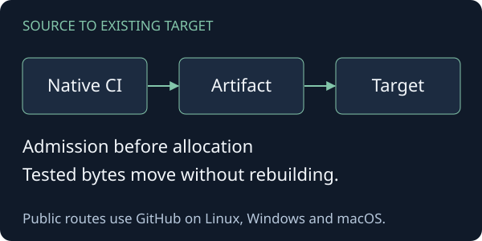

# NDDev CI/CD Workflows

A public OSS library for thin GitHub workflows, native source checks and delivery of the exact tested
artifact. Maintainers select applicable profiles and retain their existing build tools, runners and
targets. Public consumers need no private NDDev compiler, corpus or credentials.



## Try runner selection

From this checkout, prepare the locked environment and inspect the real public routes:

```sh
uv sync
uv run python examples/routing.py
```

The example reads the library's native runner labels without allocating jobs. Public Linux and Windows use x64; macOS uses ARM64. All use standard GitHub-hosted runners. Private Linux uses existing caller-owned self-hosted
capacity; private Windows/macOS require compatible confirmed no-overage admission. The
[consumer guide](docs/usage.md) explains the distinct public and private calling paths.

## Source, artifact, target

The [CI composite](.github/actions/ci/action.yml) executes profiles selected by the caller's native
contract. A short PR gate permits merge; full main CI establishes production readiness. Affected
components include changes from any superseded or failed main validation. The [admission composite](.github/actions/admit/action.yml) resolves capacity before job
allocation. The [delivery composite](.github/actions/deliver/action.yml) consumes the successful PR
artifact from successful full main CI, verifies lineage and tested-tree identity, and coordinates an
existing target. Delivery promotes that artifact without rebuilding it. Each callee resolves its own package separately from
the caller checkout. The [impact planner](.github/actions/impact/action.yml) exposes component selection
before dependent jobs allocate capacity. The [failure publisher](.github/actions/feedback/action.yml)
returns bounded native run feedback to an owning Issue without executing candidate code.

[The package README](src/nddev_cicd/README.md) explains ownership, recovery and native-tool boundaries.
The [generated profile reference](docs/profiles.md) summarizes selectable operations and points to
native command definitions. Optional public security, release preparation, OCI and bounded advanced
operations use the same implementation and explicit applicability.

## Check and maintain

Run `uv run pytest` for runtime regressions, `uv run python -m doctest docs/examples.md` for the
selected routing example, and `uv run python -m nddev_cicd reference --check` for owned reference drift.
[AGENTS.md](AGENTS.md) routes normative changes to the canonical source and implementation changes to
local checks. Ordinary documentation remains directly editable.

Native fixture drivers exercise selected SDKs and failure paths. Source workflows include public
Linux, Windows and Apple runners. Remote delivery fixtures use isolated targets and actual SSH/SCP;
main completion smoke checks artifact lineage and recovery. These checks do not establish every
SDK combination, a production deployment, or acceptance on a physical remote server.

The [normative descriptor](standard.yml), [consumer guide](docs/usage.md),
[executable example](docs/examples.md), and [origins](docs/origins.md) provide detailed navigation.
[GitHub Releases](https://github.com/NDDev-Technocracy-Standarts/std-0004-ci-cd-workflows/releases)
is the canonical journal. The source uses [AGPL-3.0-only](LICENSE); imported grants remain intact.
